<!--
  ⚡ Profile README for github.com/supriyo251017002050-dotcom
  Cyberpunk Terminal Edition
-->

<div align="center">

<table>
<tr>
<td valign="top" align="center"></td>
<td valign="top" align="center"></td>
</tr>
</table>

## ⚡ Supriyo Hara

**BCA in Data Science & AI · Techno India University, Kolkata**  
*Building intelligent computer vision systems, generative AI architectures, and neural workflows.*

<br/>

<!-- Social & Contact Badges -->
<a href="https://asthasingh29.github.io/soul-connector/" target="_blank">
  
</a>
<a href="mailto:supriyo251017002050@technoindiaeducation.com">
  
</a>
<a href="https://linkedin.com" target="_blank">
  
</a>
<a href="https://technoindiauniversity.ac.in" target="_blank">
  
</a>

<br/><br/>

<!-- Tech Stack Badges -->
<p>
  
  
  
  
  
  
  
  
  
  
</p>

<!-- Live Animated GitHub Contribution Terminal -->
<!-- Automatically refreshed daily by GitHub Actions workflow -->
<a href="https://github.com/supriyo251017002050-dotcom">
  
</a>

<br/>

<!-- Featured Works Matrix -->
<table width="860">
  <tr>
    <td width="50%" valign="top">
      <h4>🛡️ <a href="https://github.com/supriyo251017002050-dotcom/ClimateGuard-AI">ClimateGuard AI</a></h4>
      <p>An intelligent environmental risk analysis & multi-hazard intelligence engine integrating predictive algorithms for real-time risk assessment.</p>
      <code>Python</code> · <code>Vite / React</code> · <code>FastAPI</code>
    </td>
    <td width="50%" valign="top">
      <h4>🏟️ <a href="https://github.com/supriyo251017002050-dotcom/Manage-crowd">Manage-Crowd (FIFA 2026)</a></h4>
      <p>Next-gen stadium safety platform powered by Generative AI, computer vision density estimation, and real-time transit & safety analytics.</p>
      <code>Computer Vision</code> · <code>GenAI</code> · <code>Real-Time Analytics</code>
    </td>
  </tr>
  <tr>
    <td width="50%" valign="top">
      <h4>🌌 <a href="https://github.com/supriyo251017002050-dotcom/memora-vr-portfolio">Memora VR</a></h4>
      <p>Digital memorial simulation VR experience built with Team EUREKA to explore sensory preservation and immersive virtual spaces.</p>
      <code>Virtual Reality</code> · <code>Web3D</code> · <code>Team EUREKA</code>
    </td>
    <td width="50%" valign="top">
      <h4>🤖 <a href="https://github.com/supriyo251017002050-dotcom/BCA2A-Attendance-Bot">BCA2A Attendance Bot</a></h4>
      <p>Automated Telegram attendance tracking & record management bot deployed for Techno India University class operations.</p>
      <code>Python</code> · <code>Telegram API</code> · <code>Automation</code>
    </td>
  </tr>
</table>

<br/>

```terminal
[status] Online & exploring cutting-edge LLMs, Computer Vision architectures & AI agents.
```

</div>
